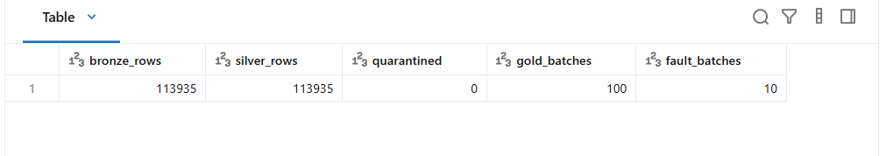
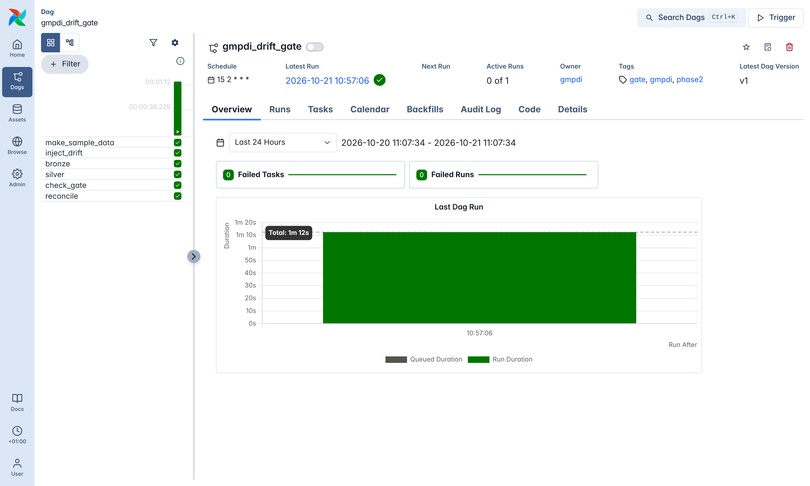

# Phase 2 gate results

**Gate: injected schema changes are caught. PASSED on 21 Oct 2026.** 10 of 10 kinds of drift were caught, both controls passed clean, and **0 of 1,206 drifted records reached silver**. The source was the real IndPenSim file (`100_Batches_IndPenSim_V3.csv`), run on isolated `*.driftgate` topics with their own registry subjects and lakehouse folder.

| Id | Drift injected | Sent | In silver | Quarantined | Caught by | Reason recorded |
|---|---|---:|---:|---:|---|---|
| S0 | control: unchanged batch | 200 | 200 | 0 | (should pass) | |
| S1 | CSV column renamed (`DO2` code → `DOT`) | 200 | 0 | 200 | source manifest + silver contract | `required_null:dissolved_oxygen_mgpl` |
| S2 | CSV column dropped (pH) | 200 | 0 | 200 | source manifest + silver contract | `required_null:ph` |
| S3 | CSV column retyped to text (`"100 rpm"`) | 200 | 0 | 200 | source manifest + silver contract | `required_null:agitator_rpm` |
| S4 | unit change, K → °C, same header | 200 | 0 | 200 | silver contract only | `out_of_range:temperature_k` |
| S5 | Avro field renamed (registry-compatible) | 200 | 0 | 200 | silver schema-id check | `unapproved_schema:5` |
| S6 | Avro field dropped (registry-compatible) | 200 | 0 | 200 | bronze decode check + schema id | `decode_failed`, `unapproved_schema:6` |
| S7 | Avro field retyped double → string | 0 | 0 | 0 | schema registry (BACKWARD), HTTP 409 | rejected before any message was sent |
| R0 | control: unchanged recall | 2 | 2 | 0 | (should pass) | |
| R1 | openFDA key renamed (`report_date` → `reportDate`) | 2 | 0 | 2 | producer key report + silver contract | `required_null:report_date` |
| R2 | openFDA date format `20260211` → `2026-02-11` | 2 | 0 | 2 | silver contract | `bad_format:report_date` |
| R3 | openFDA code list `Class II` → `Class 2` | 2 | 0 | 2 | silver contract | `not_allowed:classification` |

Every quarantined record keeps its payload, raw Kafka bytes, Kafka key and offset, and the full list of reasons. Every reason raised an alert row (`alerts/contract_violations`). The reconciliation check accounts for all 1,408 driftgate bronze records: 202 in silver and 1,206 in quarantine.

Reproduce: `docker compose run --rm app python -m drift.inject --csv data/raw/<file>.csv` with `GMPDI_TOPIC_SUFFIX=.driftgate`, then bronze, silver and `python -m drift.check` (README → Phase 2). The same gate runs in CI on synthetic data and nightly in Airflow (`gmpdi_drift_gate`).

## The real data through silver and gold

| Check | Result |
|---|---|
| Process readings: bronze → silver | 113,935 → 113,935, 0 quarantined (the contract ranges were set from the real data with margin, then verified on every reading) |
| openFDA recalls (live, last 365 days) | 840 in silver, **2 quarantined**: real records with recall number `"N/A"` (`bad_format:recall_number`) |
| Reconciliation | process: 113,935 = 113,935 silver + 0 quarantined + 0 unaccounted; recalls: 883 = 840 silver + 41 duplicates (overlapping fetches) + 2 quarantined + 0 unaccounted |
| Re-running silver | 0 new rows (insert-only MERGE + checkpoint) |
| `gold/batch_summary` | 100 batches. Mean final titre by campaign: Raman/PAT control 29.4 g/L, recipe-driven 24.3, operator-controlled 21.5, fault batches 14.4 |
| `gold/golden_profile` | 291 process hours with p10/p50/p90 across the 90 normal batches. Hours with fewer than 20 batches are flagged `low_support` (batches end between ~200 and 290 h) |
| `gold/recall_summary` | 38 month × class rows; 229 of 840 recalls cite CGMP |

## Databricks (Free Edition), deployed with Terraform

`terraform apply` (infra/databricks): **2 added, 2 changed, 0 destroyed**. That adopted the schema and volume Phase 1 had created by hand, and added a Git folder pinned to `main` and the `gmpdi-lakehouse` job. One run of the job (bronze Auto Loader → silver/gold notebook, serverless) gave the same numbers as the local pipeline:

| | Local (Docker, Spark 4.0.4) | Databricks (serverless) |
|---|---:|---:|
| Bronze readings | 113,935 | 113,935 |
| Silver | 113,935 | 113,935 |
| Quarantined | 0 | 0 |
| Gold batches / fault batches | 100 / 10 | 100 / 10 |

Same contracts, same transform functions (`lakehouse/silver.py`, `lakehouse/gold.py`); only the I/O differs.

## Orchestration

Both DAGs ran green in Airflow 3.3.2, in the sandbox and again on a Windows laptop (Docker Desktop), where the Phase 2 gate was also reproduced from the VS Code task. Each task is a container started from the project's own images:

- `gmpdi_lakehouse` (hourly): bronze → silver → gold + reconcile, 1 min 45 s on the real data with nothing new to load.
- `gmpdi_drift_gate` (nightly): sample data → inject → bronze → silver → gate check + reconcile, 1 min 12 s.

## Two defects the drift gate found in my own code

1. **Phase 1's `decode_ok` flag was wrong.** Spark 4's `from_avro` in PERMISSIVE mode does not return null for bytes it cannot decode. It returns a struct with every field null. Bronze checked `payload IS NOT NULL`, so S6's 200 garbage rows were marked as decoded. They were still quarantined (40 `required_null` reasons each), but their keys were gone and the alert was misleading. Fix: a record counts as decoded only if every field the Avro schema declares non-nullable is present (`bronze.non_nullable_fields`). Silver also treats a record without its key as a decode failure, and quarantine keeps the Kafka key, so even an undecodable record can be traced to its batch.
2. **A registry-compatible rename decodes perfectly.** S5's renamed field decoded into the old column name with correct values (298.22 K for batch 9501). BACKWARD compatibility protects consumers that use the new schema. It does nothing for a consumer that decodes every message with one fixed schema, which is what bronze does. The only safe guard is the schema id in the message header, so silver accepts only ids registered from an approved `.avsc`.

Synthetic data also got stricter. The first silver run on the old sample data quarantined all 6,016 rows: vessel volume of ~1 L, broth removal as a positive flow, negative penicillin. The generator now produces values in realistic ranges, so CI exercises the real contract.
