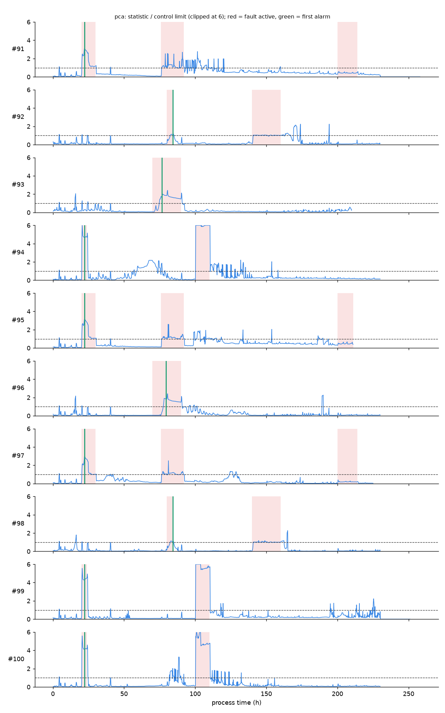

# Phase 3 gate results

**Gate: faults are caught on held-out batches. PASSED on 23 Oct 2026, on the first and only scoring of the test batches.** The real IndPenSim file was used, and the result is identical whether the model reads silver Delta or the CSV.

## Order of events (all on GitHub)

1. **23:10, commit 589a0ae:** batch split and pass criteria pre-registered (`models/gate_criteria.json`).
2. **23:21, commit 927ee77:** both detectors trained, tuned on calibration data only, frozen with SHA-256 manifests. The gating model was selected by a rule fixed in code (`models/artifacts/selection.json`).
3. **23:22, commit a5867d9:** the evaluation script committed.
4. **23:22:51:** the test batches scored once. The report is `phase3_gate.json` in this folder.

## Result

| Held-out test (15 normal batches + faults 91–100) | PCA T² + SPE (gating) | LSTM autoencoder |
|---|---:|---:|
| Fault batches detected after onset (criterion ≥ 8/10) | **10 / 10** | 10 / 10 |
| False-alarm batches (criterion ≤ 2) | **1** | 2 |
| Alarms before a fault started | 0 | 0 |
| Median detection delay | **2.2 h** | 2.7 h |
| Slowest detection | 9.4 h (batch 96) | 11.2 h |
| Reading-level ROC AUC | **0.931** | 0.902 |
| Fault episodes caught (post-hoc) | 18 / 21 | 18 / 21 |



Red bands mark active faults (simulator ground truth), the green line is the first alarm, and the dashed line is the control limit.

## What drove each alarm

Per-signal contributions over the 2 hours before the first alarm, computed without the model knowing the fault types:

| Batches | Top signals | Reads as |
|---|---|---|
| 94, 99, 100 | aeration rate, off-gas CO₂, off-gas O₂ | air supply |
| 92, 98 | pH, acid flow, base flow | pH control |
| 93, 96 | temperature, cooling water flow | temperature control |
| 91, 95, 97 | sugar feed, oxygen uptake, off-gas O₂ | substrate feed |

## The honest caveats

- **Per-episode detection is 18 of 21**, a post-hoc finding: the chart showed fault batches contain 2–3 separate episodes, while the pre-registered gate is per batch. All 3 misses are the late third episode (~200 h) of the substrate-feed batches, so this limitation is in the model card.
- **The one false alarm, batch 32 at 87.8 h,** is a real acid-dosing and temperature excursion in a batch the simulator labels normal.
- **Tuning used synthetic faults injected into calibration batches,** not IndPenSim's own fault types. On those the PCA caught 74% of steps and drifts and only 22% of stuck sensors, a known blind spot.

Reproduce:

```
docker compose run --rm app python -m models.evaluate --source /lakehouse/silver/process_sensor
docker compose run --rm app python -m models.episodes --source /lakehouse/silver/process_sensor
```

Or in VS Code, run the task **Phase 3 (all steps)**.
